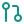

<!-- readme-standard: 2026-11-02 -->
<div align="center">



# Gratitude Token Project — Astro Site 🙏

*Sidecar Astro site for the Ethereal Offering Protocol — changelog-as-content and a scrubbed structure map, published separately from the main dApp.*


[](LICENSE)
[](https://drasticstatic.github.io/gratitude-token-project_astro-public/) [](https://github.com/drasticstatic/gratitude-token-project_astro/actions/workflows/sync-public-allowlist.yml) [](https://code.claude.com/docs/en/overview) [](https://github.com/drasticstatic/gratitude-token-project_astro)

 **You are here:** drasticstatic lab › Ethereal Offering › `gratitude-token-project_astro` · private source · `main` is the working branch · public twin `gratitude-token-project_astro-public`

</div>

##  TL;DR

1.  **What this is.** A sidecar Astro site for the Ethereal Offering Protocol. It holds the initial scaffold; the pages are not populated yet.
2.  **Who it is for.** Whoever picks it up; use the changelog template when finishing it.
3.  **Do this first.** [Explore the public preview](https://drasticstatic.github.io/gratitude-token-project_astro-public/).

**🌐 [Explore the Public Preview →](https://drasticstatic.github.io/gratitude-token-project_astro-public/)**

---

## Table of Contents

- [👋 What This Is](#what-this-is)
- [🔒 Private / Public Split](#private-public-split)
- [💻 Local Development](#local-development)
- [🏗️ Structure](#structure)

---

<a id="what-this-is"></a>
## 👋 What This Is

Sidecar [Astro](https://astro.build) site for the
[gratitude-token-project](https://github.com/drasticstatic/gratitude-token-project) dApp
(the "Ethereal Offering Protocol"). It publishes two things the main dApp repo doesn't:

- **Changelog-as-content pages** — the project's `changelog.md` rendered as a public,
  browsable site.
- **A scrubbed structure map** — contract/module relationships only (via
  [graphify](https://github.com/drasticstatic/gratitude-token-project/tree/main/graphify-out)),
  with no source snippets.

Neither is populated yet — this repo currently holds the initial site scaffold only.

**Breadcrumb, 2026-09-23:** when this gets finished, use
[`my-template/changelog-template/`](https://github.com/drasticstatic/my-template/tree/main/changelog-template)
rather than building the changelog-as-content pages from scratch — same content-collection pattern
this repo already anticipated, now proven out as PIR's and THEF's
`changelog-astro`/`changelog-astro-public` pairs (see that README's "future adopters" section,
which names this repo specifically — "dappU MVP"). Public repo target stays `drasticstatic`-owned
(personal project, not a community-owned org), same as today.

---

<a id="private-public-split"></a>
## 🔒 Private / Public Split

This repo is **private** and is the source of truth. A public sibling,
[`gratitude-token-project_astro-public`](https://github.com/drasticstatic/gratitude-token-project_astro-public),
mirrors only what's explicitly allowlisted, pushed automatically by
[`sync-public-allowlist.yml`](.github/workflows/sync-public-allowlist.yml) on every push to
`main`. This is a direct private→public flow (same pattern as
[`pir-devine-news`](https://github.com/drasticstatic/pir-devine-news) →
`pir-devine-news-public`) — there is no `-preview` staging lane.

Everything not named in the sync workflow's `public_allowlist` stays private by default,
including this repo's agent orchestration files, its specs and notes, and
`HANDOFF-create_astro-workspace-proposal.md`.

---

<a id="local-development"></a>
## 💻 Local Development

```bash
npm install
npm run dev       # dev server
npm run build      # production build to dist/
npm run preview    # preview the production build
```

Requires Node.js `>=22.12.0`.

---

<a id="structure"></a>
## 🏗️ Structure

```
src/pages/   Astro pages (currently just a placeholder homepage)
public/      Static assets served as-is
```

---

*Built and maintained by [drasticstatic](https://github.com/drasticstatic) · w/ Anthropic's Claude Code CLI*

##  Suggest a change

Noticed something? Open an [issue](../../issues) or a pull request against `main`; Christopher reads them and a person with the role merges. Not on GitHub? Reach Christopher through [his contact page](https://drasticstatic.github.io/resume/pages/contact.html).

<sub>The front door follows the living [README standard](https://github.com/drasticstatic/my-template/blob/main/README-STANDARD.md). Copy it, improve it.</sub>
